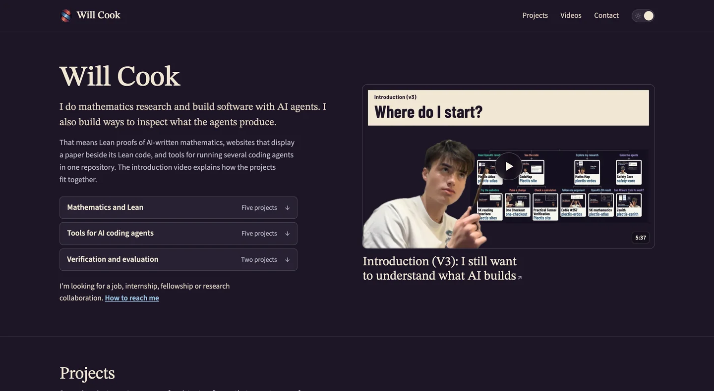

# Will Cook

I do mathematics research and build software with AI agents. I also build ways to inspect what the agents produce.

**[Projects, papers and videos](https://wcook04.github.io/)**

[Mathematics and Lean](https://wcook04.github.io/#group-mathematics) · [Tools for coding agents](https://wcook04.github.io/#group-agents) · [Verification and evaluation](https://wcook04.github.io/#group-verification)

[Watch the introduction](https://www.youtube.com/watch?v=MBmVMMogXTA) · [YouTube channel](https://www.youtube.com/@willcook2004)

I’m looking for a job, internship, fellowship or research collaboration. [Email me](mailto:williamwkcook@gmail.com).

<!-- Source map: README.md owns the profile copy; assets/homepage-dark.webp is a
1440 × 790 capture of wcook04.github.io at 323e9f8, made on 6 November 2026.
Refresh the preview from the real homepage after material layout changes. -->
